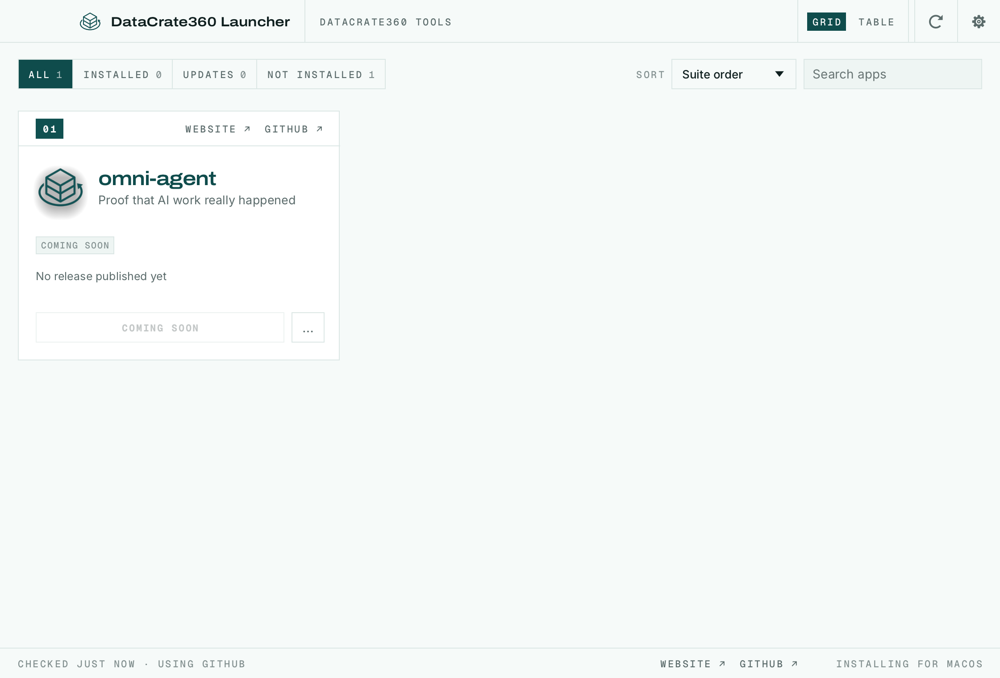

<p align="center"></p>

<h1 align="center">DataCrate360 Launcher</h1>

<p align="center">Install, update and open the DataCrate360 tools from one small native app.</p>

<p align="center"></p>

## What it is

DataCrate360 Launcher lists every DataCrate360 tool, shows which ones you have and which version,
installs the right build for your operating system and processor from the tool's GitHub
Releases, and tells you when an update is out. It is written in Rust only: the desktop app is
native [egui](https://github.com/emilk/egui) (no Electron, no web view), and the same UI compiles
to WebAssembly for a browser catalog. It can sit in your menu bar or system tray.

Today the catalog has one tool:

| Tool | What it is for | Repository |
|---|---|---|
| **omni-agent** | Proof that AI work really happened | [`datacrate360/omni-agent`](https://github.com/datacrate360/omni-agent) |

omni-agent has no published release yet, so the launcher shows it as **Coming soon** until one
appears. Adding a tool is one row in [`crates/core/src/catalog.rs`](crates/core/src/catalog.rs)
(plus its tagline in each UI catalog).

### Safety

- Downloads come only from GitHub Releases of repositories under
  [`github.com/datacrate360`](https://github.com/datacrate360).
- Every download is checked against the release's `SHA256SUMS.txt` before anything is installed;
  a release without checksums is refused.
- A running app is never replaced, and nothing outside what the launcher installed is deleted.

## Interface languages

The interface is in English, Brazilian Portuguese (Português (Brasil)), Czech (Čeština), French
(Français), German (Deutsch), Hungarian (Magyar), Japanese (日本語), Polish (Polski), Russian
(Русский), Simplified Chinese (简体中文) or Spanish (Español). **Auto**, the default, follows the
system or browser language; **Settings → Language** picks one and switches at once, and the choice
is kept between runs. Czech locales (`cs-CZ`, `cs_CZ.UTF-8`…) select Czech, German ones (`de-DE`,
`de-AT`, `de-CH`, `de_DE.UTF-8`…) German, French ones (`fr-FR`, `fr-CA`…) French, Hungarian ones
(`hu`, `hu-HU`, `hu_HU.UTF-8`…) Hungarian, Japanese ones (`ja`, `ja-JP`, `ja_JP.UTF-8`…) Japanese,
Polish ones (`pl`, `pl-PL`, `pl_PL.UTF-8`) Polish, Spanish ones (`es-ES`, `es-MX`, `es-419`…)
Spanish, and Portuguese ones (`pt-BR`, and `pt-PT` too, for now) Brazilian Portuguese. Simplified
Chinese locales (`zh-CN`, `zh-SG`, `zh-Hans`, and POSIX forms such as `zh_CN.UTF-8`) select
Chinese; Traditional Chinese ones don't. To try a language without changing the setting, start the
desktop app with `DATACRATE360_LAUNCHER_LOCALE=pt-BR`, or add `?lang=ru` to the web address.

The CJK languages are drawn with the system's own CJK font (Hiragino Sans or PingFang on macOS,
Yu Gothic, Meiryo or Microsoft YaHei on Windows, Noto Sans CJK, IPA, Takao or WenQuanYi on Linux and
FreeBSD). Where the system has no font for one, and in the web version, the interface stays in
English and Settings says why. Product names and release notes stay as published; text without a
translation falls back to English.

## Where apps are installed

DataCrate360 Launcher installs each app where your system normally keeps applications, using the
app's official release package, so an app installed by the launcher is the same as one you
installed by hand (and the launcher finds apps you installed yourself):

| System | Where | How |
|---|---|---|
| macOS | `/Applications/<App>.app` | Copied from the release DMG |
| Windows | `C:\Program Files\<App>` | The release MSI, through Windows Installer (with Start menu entry and Apps & features entry) |
| Linux | `/usr/bin`, `/usr/share/applications` | The release `.deb` (apt) or `.rpm` (dnf, zypper), with your system's password prompt. Without those, a Flatpak, or an AppImage in `~/Applications` |
| Linux, inside the launcher's Flatpak, with no Flatpak on the host | `~/.var/app/com.datacrate360.launcher/data/datacrate360-launcher/apps/<app>` | The release tarball, unpacked into the launcher's own folder and run inside the same sandbox, with its settings in a `home/` folder beside it. Nothing is installed on the host, and each app's configuration stays in the sandbox |
| FreeBSD | `/usr/local` | The release tree, with a password prompt (polkit); `~/.local` when polkit isn't installed |

DataCrate360 Launcher keeps itself current too: when a new version is out, **Update and restart**
downloads it, verifies it, puts it where this copy is installed (the `.app`, the Windows Installer
package or portable folder, the AppImage, or the `.deb`/`.rpm`) and reopens it.

Updates use the same format an app was installed with. Every download is checked against the
release's published SHA-256 before it is installed, and a running app is never replaced.

The launcher writes its log to `logs/datacrate360-launcher.log` in its data folder
(`~/.local/share/datacrate360-launcher` on Linux, `~/Library/Application Support/DataCrate360 Launcher`
on macOS, `%LOCALAPPDATA%\DataCrate360 Launcher` on Windows, `DataCrate360LauncherData` beside the
portable zip's executable) and keeps the previous two runs as `datacrate360-launcher.1.log` and
`datacrate360-launcher.2.log`. `RUST_LOG` changes what it records (`debug`, `info,zbus=warn`, …).

## Install

There is no published release of DataCrate360 Launcher yet. Build it from source (below), or make
a macOS disk image yourself:

```sh
packaging/macos/package.sh --arch aarch64   # or universal; ad-hoc signed without MACOS_SIGN_IDENTITY
open dist/release/datacrate360-launcher-0.4.1-macos-aarch64.dmg
```

An ad-hoc signed build runs on the Mac that built it; other Macs' Gatekeeper rejects it until it is
signed with a Developer ID and notarized (`MACOS_SIGN_IDENTITY`, `APPLE_ID`, `APPLE_PASSWORD`,
`APPLE_TEAM_ID`; see the top of `package.sh`). Windows, Linux, FreeBSD and web packaging scripts are
in [`packaging/`](packaging/) but are untested in this repository.

## Build from source

You need a recent stable Rust (1.90 or newer). On Linux, install the windowing headers first
(Debian/Ubuntu: `sudo apt install libxkbcommon-dev libwayland-dev libx11-dev libxrandr-dev libxi-dev libgl1-mesa-dev`).

```sh
cargo run --release -p datacrate360-launcher   # the desktop app
cargo xtask ci                                 # fmt, clippy, tests and the wasm check
```

The web version builds with [trunk](https://trunkrs.dev/):

```sh
rustup target add wasm32-unknown-unknown
cd apps/datacrate360-launcher-web && trunk serve
```

Icons are rendered from [`assets/brand/`](assets/brand/) by [`packaging/icons.sh`](packaging/icons.sh)
(macOS `sips`, plus `cargo xtask ico` / `icns`); the outputs are committed.

`DATACRATE360_LAUNCHER_SELF_SCREENSHOT=/path/to/shot.png` makes the desktop app save a picture of
its own window six seconds after start (it needs no screen-recording permission); that is how
`docs/screenshots/launcher.png` was made.

### Installing your own builds

To install tools from checkouts on your machine instead of GitHub, clone them next to this repo
(`../omni-agent`) and run:

```sh
cargo xtask local sync      # build and package each new version into ../local-mirror
cargo xtask local serve     # serve the builds and a release feed on http://127.0.0.1:8787/
DATACRATE360_LAUNCHER_DOWNLOAD_BASE=http://127.0.0.1:8787/ cargo run --release -p datacrate360-launcher --features local-mirror
```

Only builds with the `local-mirror` feature read `DATACRATE360_LAUNCHER_DOWNLOAD_BASE`, and only
loopback addresses are accepted; release builds never have it.

New contributors and AI agents: start with [`AGENTS.md`](AGENTS.md).

## License and credits

DataCrate360 Launcher is licensed under either of [MIT](LICENSE-MIT) or
[Apache-2.0](LICENSE-APACHE), at your option. The DataCrate360 name and logo are DataCrate360's
brand assets and are not covered by those licenses ([`NOTICE`](NOTICE)).

**Credits.** DataCrate360 Launcher is derived from
[ArtCraft Launcher](https://github.com/storytold/craft-launcher), Copyright (c) 2026 ArtCraft Team
and the ArtCraft Launcher contributors, MIT OR Apache-2.0. Thank you to its authors for the
installer, updater, release-verification and UI work this project builds on. ArtCraft and its
logos are trademarks of the ArtCraft Team; they are not used here, and this project is not
affiliated with or endorsed by them. Fonts: Inter, Archivo and Geist Mono (SIL OFL 1.1); see
[`ATTRIBUTION.md`](ATTRIBUTION.md).
